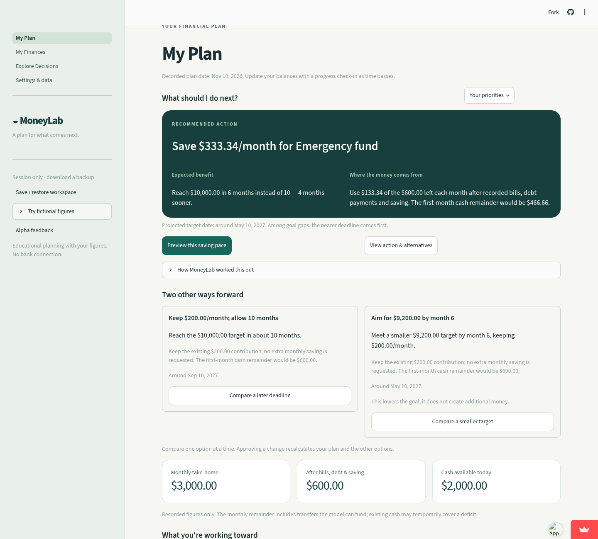
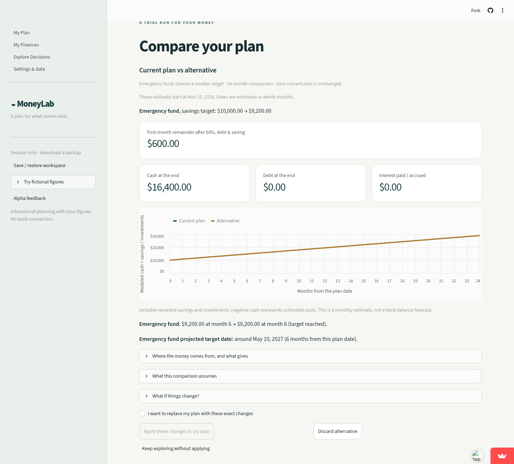
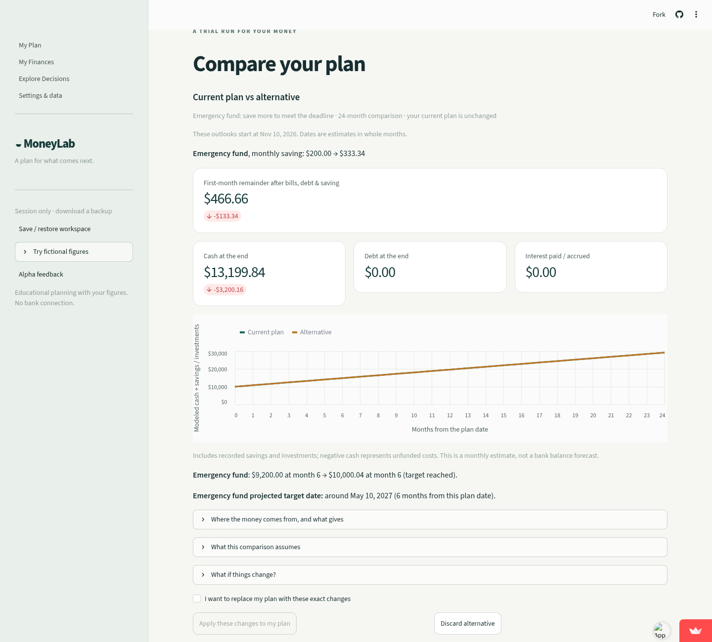
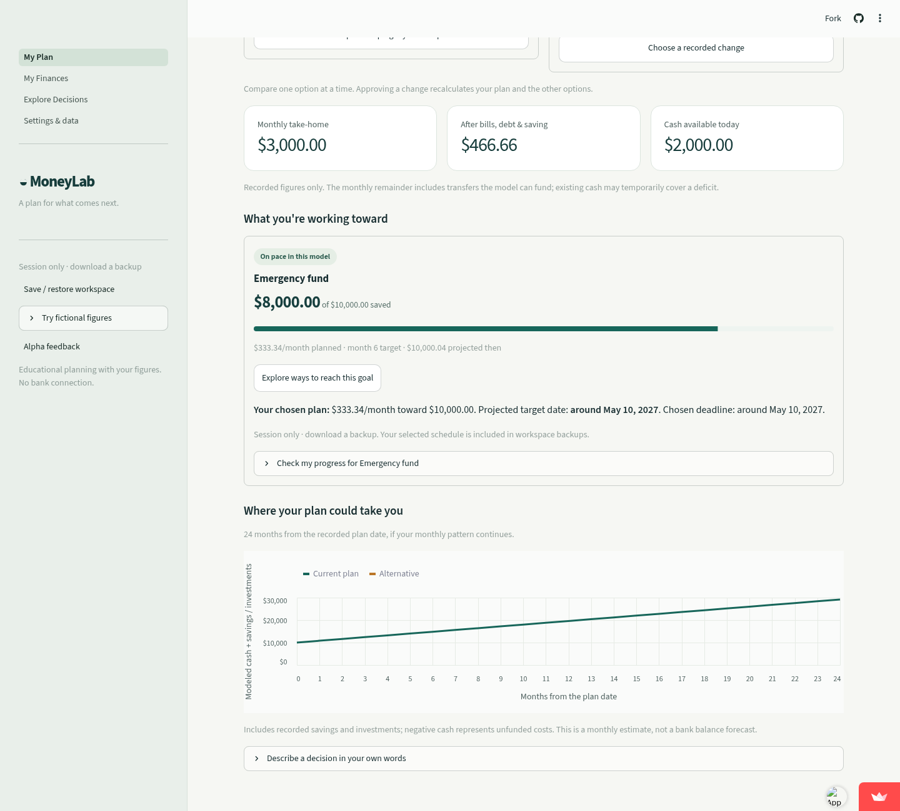
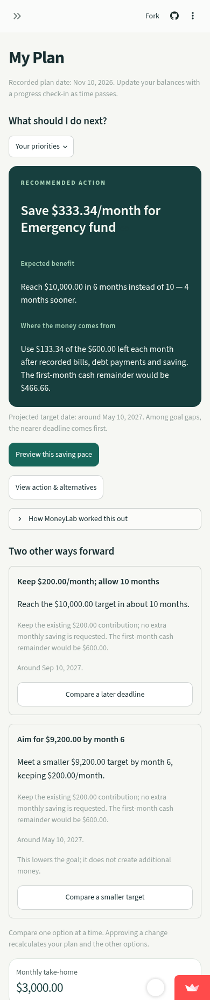
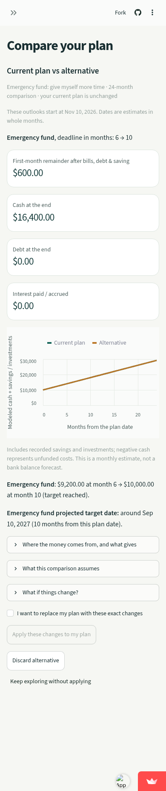
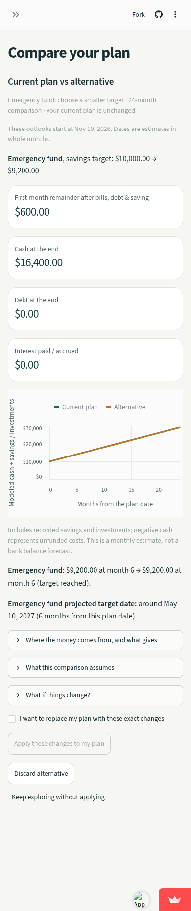
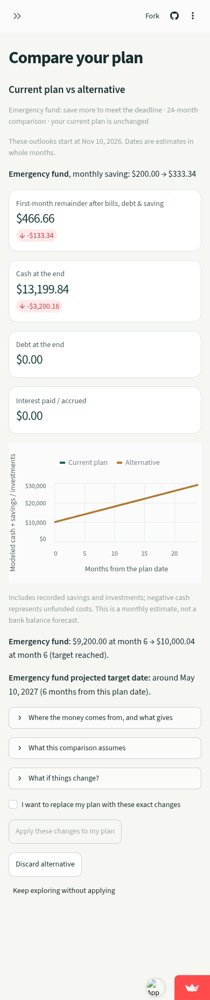
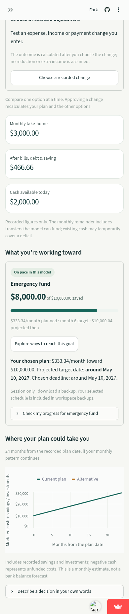

# MoneyLab: completed deployed user journey

[Open the live app](https://moneylab-dev.streamlit.app/) · [Merged implementation](https://github.com/jbj-02/moneylab/pull/8) · [Validation record](validation.json)

Captured from the actual deployed app on November 10, 2026 at 6:59 PM Eastern, using fictional figures. Deployment commit: `533dbe46754717c2774b24558d9905af86631f86`. Both desktop (1440 × 1000) and mobile (390 × 844) journeys passed. Screenshots use taller viewports at the same widths to include the page content; they are unedited browser captures.

Checks passed: visible recommendation, benefit, funding source and two alternatives; collapsed calculations that open and close; both alternatives opened and discarded; exported figures unchanged during exploration; explicit approval saved the chosen $333.34/month schedule. Normal TLS verification remained enabled.

492 Python tests and all 12 desktop/mobile regression journeys passed, including local persistence and deletion. [CI browser run](https://github.com/jbj-02/moneylab/actions/runs/42927294145) · [CI Python run](https://github.com/jbj-02/moneylab/actions/runs/42927294135)

The example starts with $8,000 saved toward $10,000, $200/month planned, and $600 monthly room. MoneyLab recommends $333.34/month, taking an extra $133.34 from that room and leaving $466.66. The visible alternatives keep $200/month and allow ten months, or reduce the six-month target to $9,200.

## Desktop

### Recommendation, benefit, funding and two alternatives

### Alternative: keep $200/month and allow ten months

### Alternative: a smaller $9,200 target at six months

### Recommended option before explicit approval

### Approved plan with the chosen $333.34/month schedule

## Mobile

### Recommendation, benefit, funding and two alternatives

### Alternative: keep $200/month and allow ten months

### Alternative: a smaller $9,200 target at six months

### Recommended option before explicit approval

### Approved plan with the chosen $333.34/month schedule

