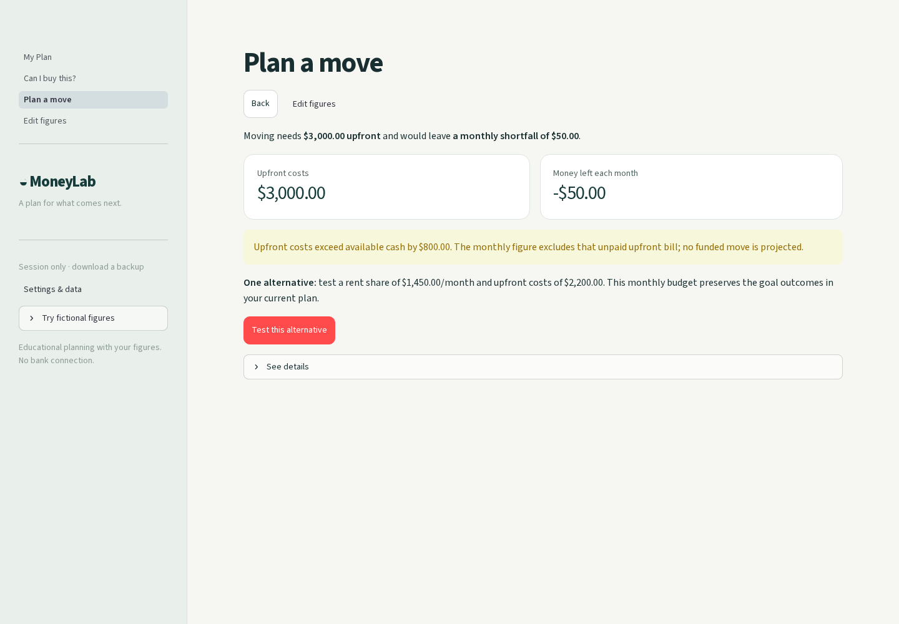
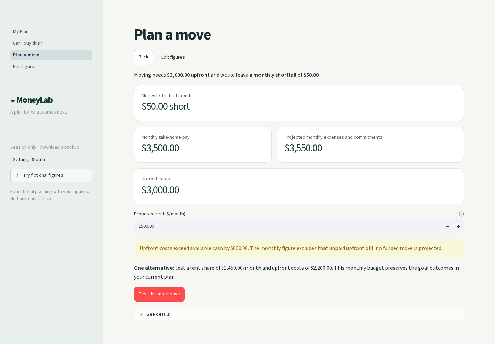
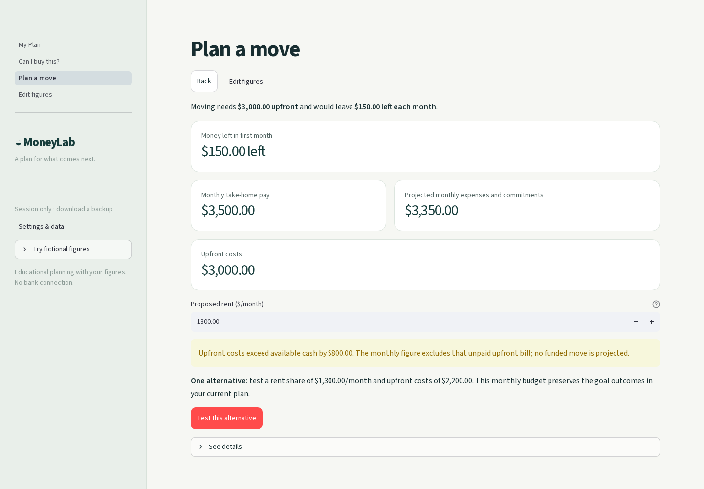
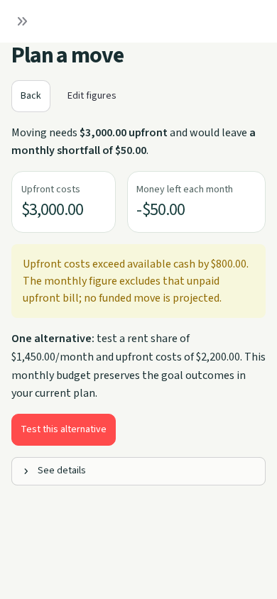
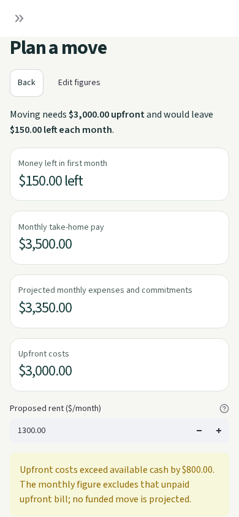

# Move result monthly summary and rent edit

Validated locally in Chromium from the latest `main` baseline (`0b812b1`) and the feature branch, using fictional figures only.

The scenario uses $3,500 monthly take-home pay, $1,900 in other monthly commitments, $150 in added monthly bills, $2,200 available cash, and $3,000 in move-in costs. At $1,500 rent, the existing Python engine projects $3,550 in expenses and commitments and a $50 first-month shortfall. Committing a $1,300 rent on the result screen recalculates the temporary scenario to $3,350 in commitments and $150 left. The upfront cash shortfall remains $800.

The test checks both 1440 × 1000 desktop and 390 × 844 mobile viewports. It also checks for application exceptions and horizontal overflow. The Python UI test verifies that the saved source blocks remain byte-for-byte equivalent while the temporary result and draft rent change.

| Viewport | Before | New summary at $1,500 rent | After editing rent to $1,300 |
| --- | --- | --- | --- |
| Desktop | [Open](desktop-before-move-result.png) | [Open](desktop-after-move-result.png) | [Open](desktop-after-rent-edited.png) |
| Mobile | [Open](mobile-before-move-result.png) | [Open](mobile-after-move-result.png) | [Open](mobile-after-rent-edited.png) |

## Desktop

## Mobile

