# MoneyLab: result first

Before: `main` at `533dbe4`. After: `feature/result-first-experience`. These are actual local browser captures with fictional figures, not production screenshots. Both use the same $5,000 goal, $3,620 saved, $100/month saving, $2,400 pay, $2,300 total spending and $300 dining expense.

Journeys ran at 1440 × 1000 and 390 × 844. Captures use 1100px height at the same widths to show the content. PNGs are unedited browser captures.

517 Python tests, 22 desktop/mobile browser journeys, and local persistence/deletion pass. The CI checks on the pull request repeat both browser suites.

## Before and after

| Desktop before | Desktop after |
| --- | --- |
| 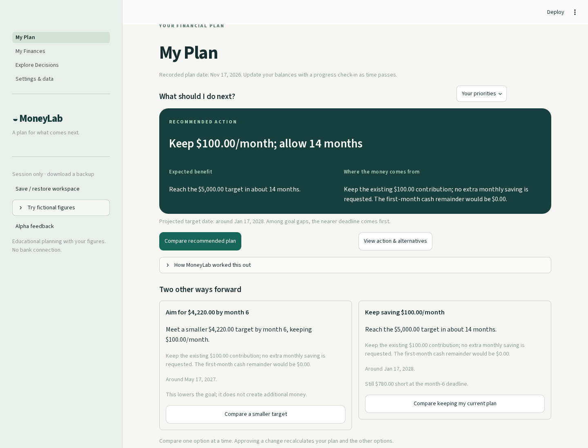 |  |

| Mobile before | Mobile after |
| --- | --- |
| 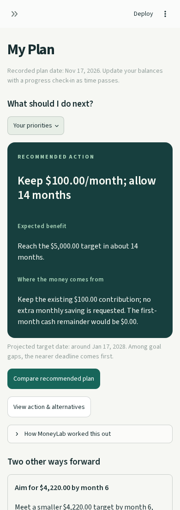 | 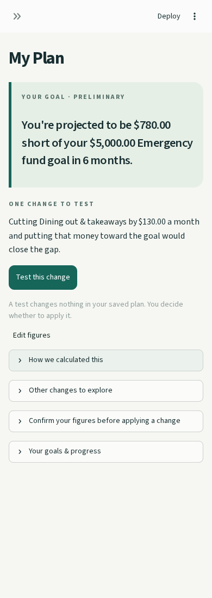 |

## What changed

The old dashboard recommends giving the goal more time and puts explanation and alternatives in competing sections. The redesign first says the user is $780 short in six months, then proposes a modeled $130/month cut to the recorded dining entry and offers one test. The comparison shows $4,220 versus $5,000 at the goal deadline, with $0 left each month in both plans.

The journey then explicitly edits pay to $2,500. The previous comparison becomes stale and cannot apply. A fresh test uses $100 of monthly room plus a $30 dining cut; approval records $230/month saving and $270/month dining. Exports prove that testing alone preserved the original figures.

## Full set of captured states

### Desktop

**Before: welcome**

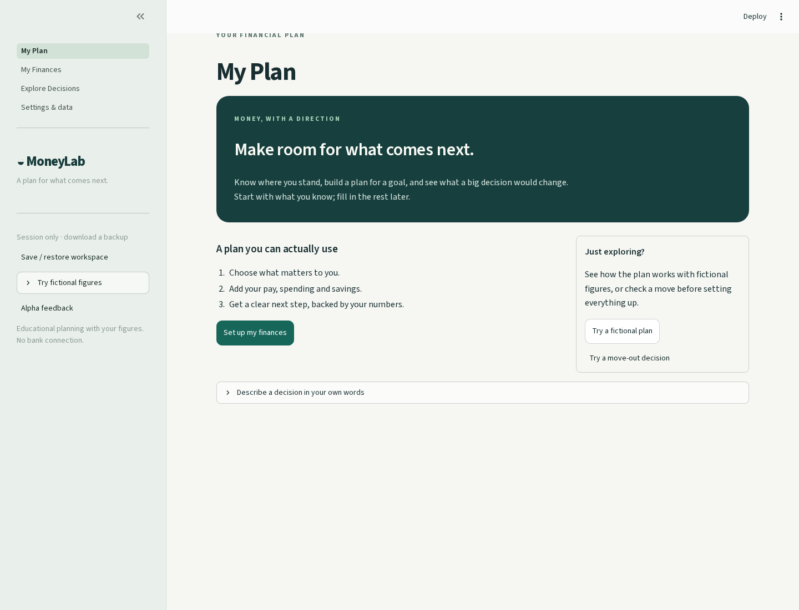

**After: choose a goal, purchase or move**

**Current plan and tested change**

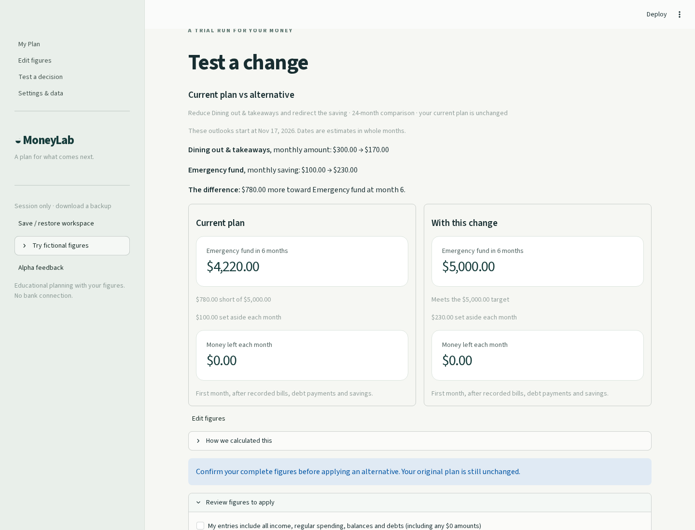

**An on-track goal**

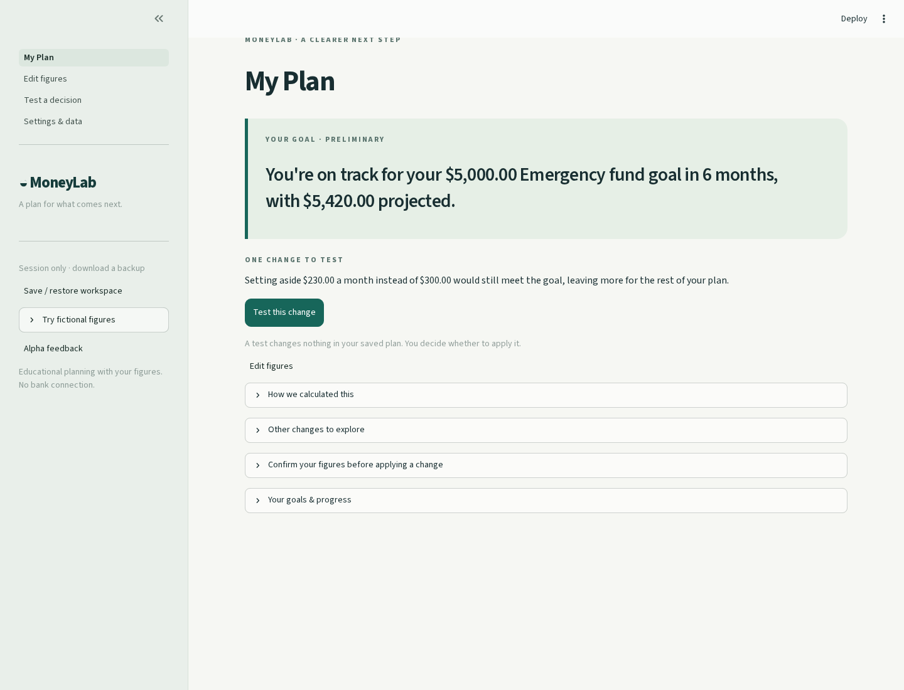

**A deadline not met; a modeled later date**

**A specific missing figure, not a zero**

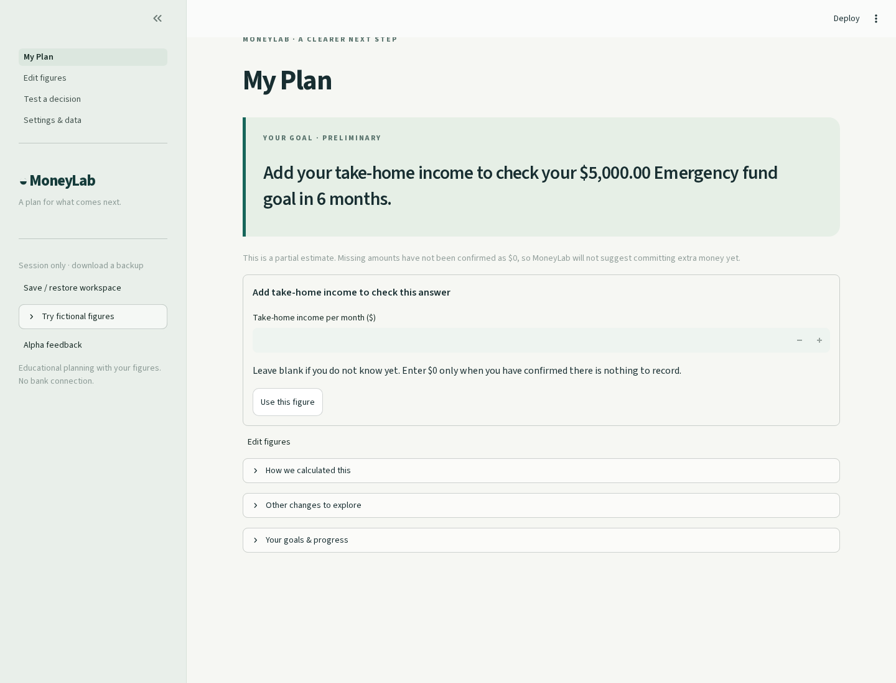

**Selected schedule after explicit approval**

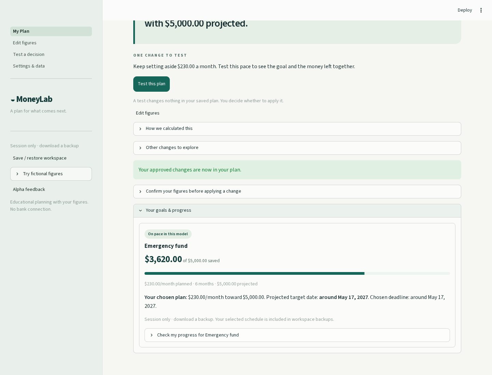

### Mobile

**Before: welcome**

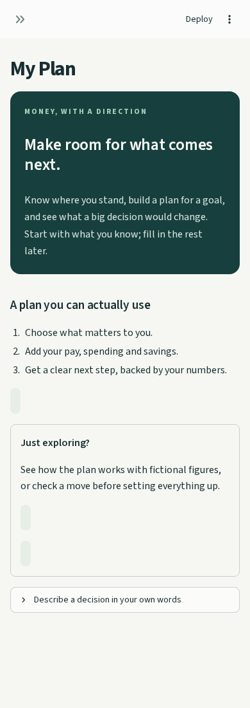

**After: choose a goal, purchase or move**

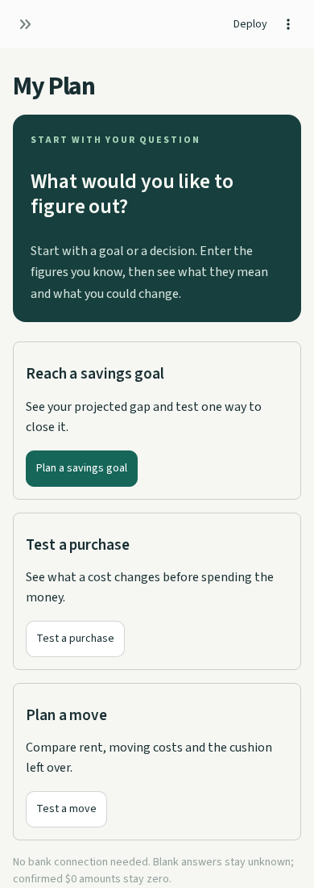

**Current plan and tested change**

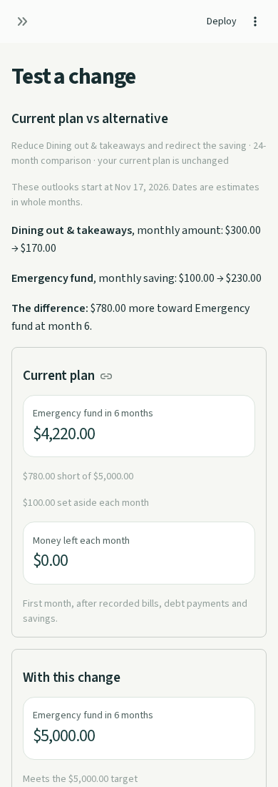

**An on-track goal**

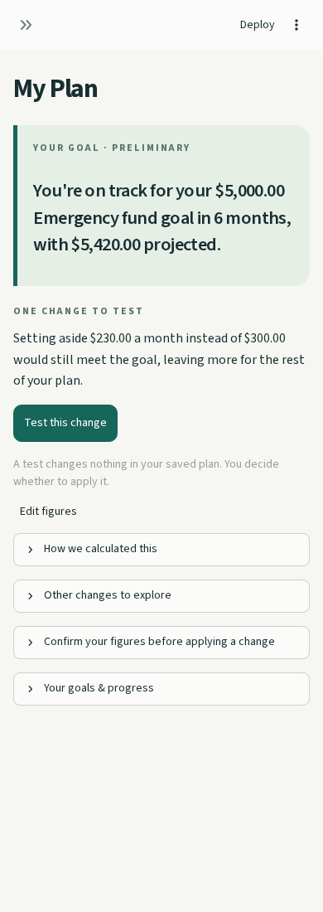

**A deadline not met; a modeled later date**

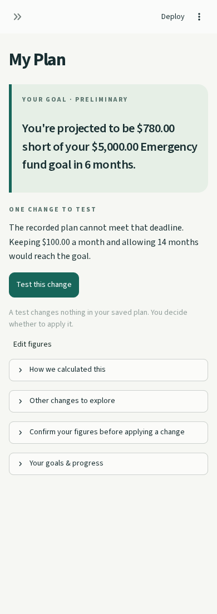

**A specific missing figure, not a zero**

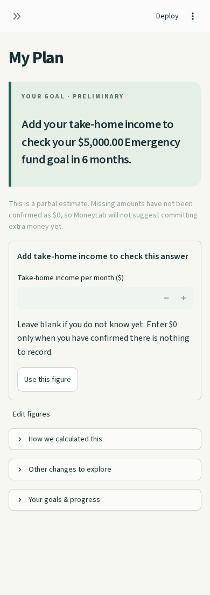

**Selected schedule after explicit approval**

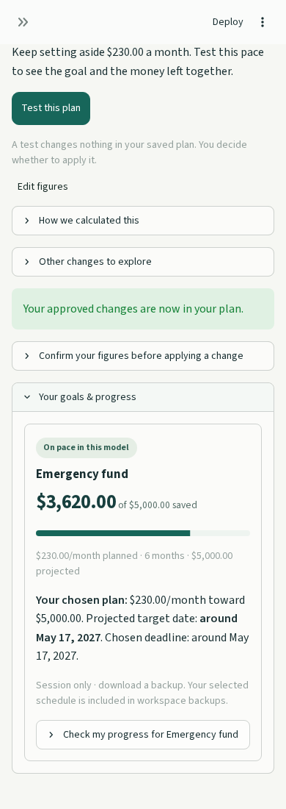
