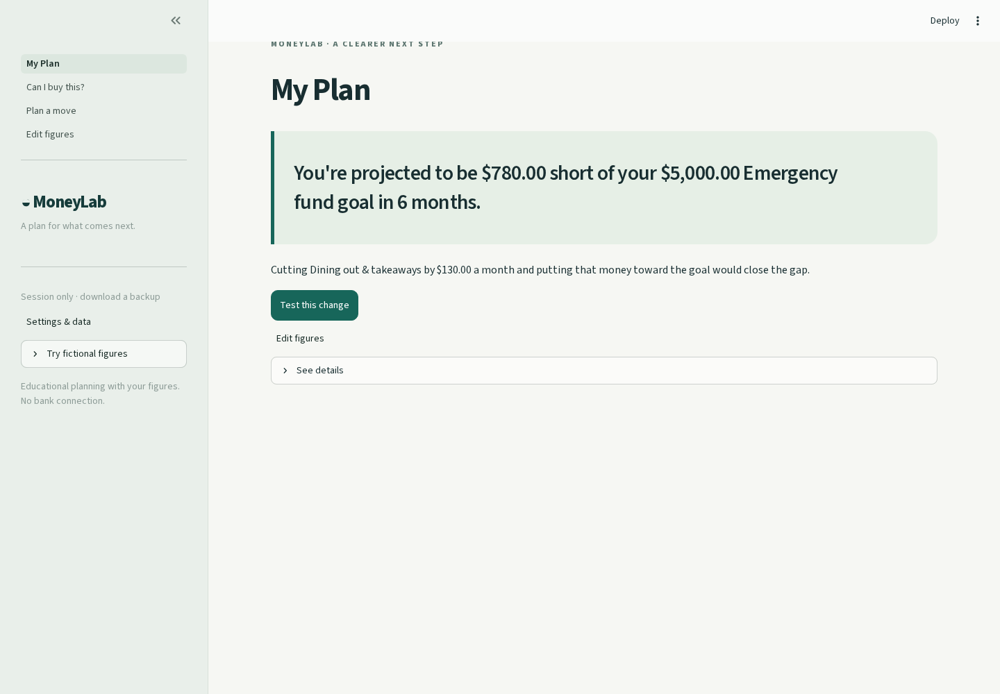
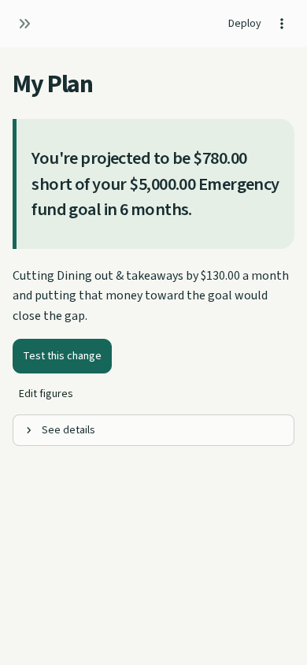
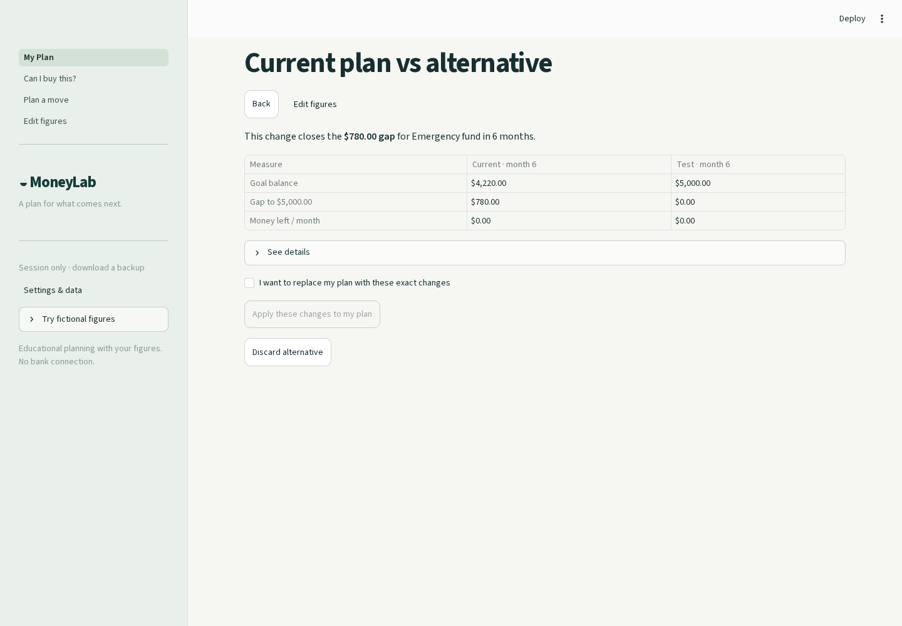
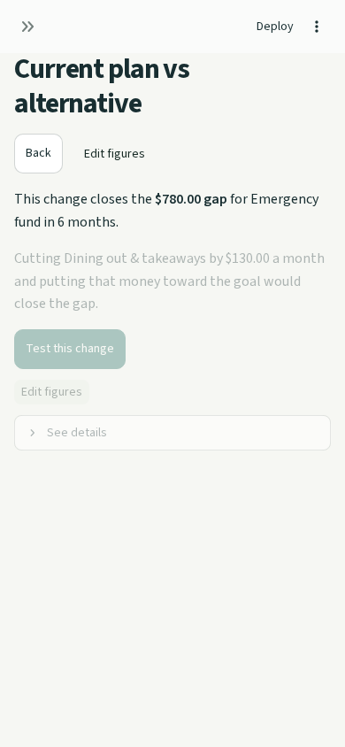
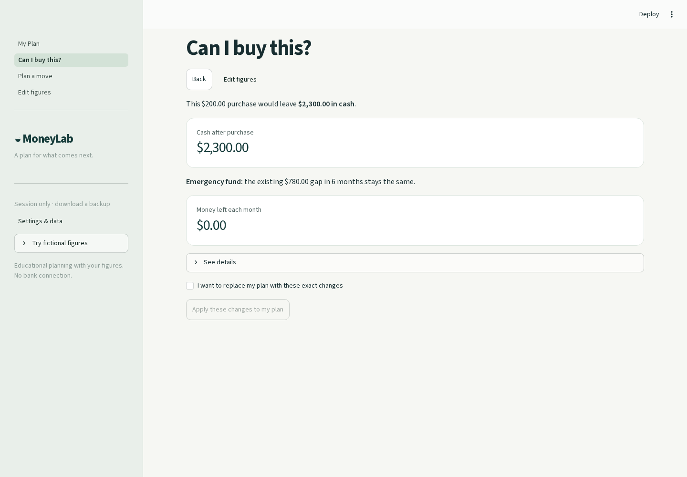
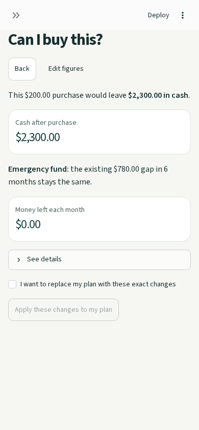
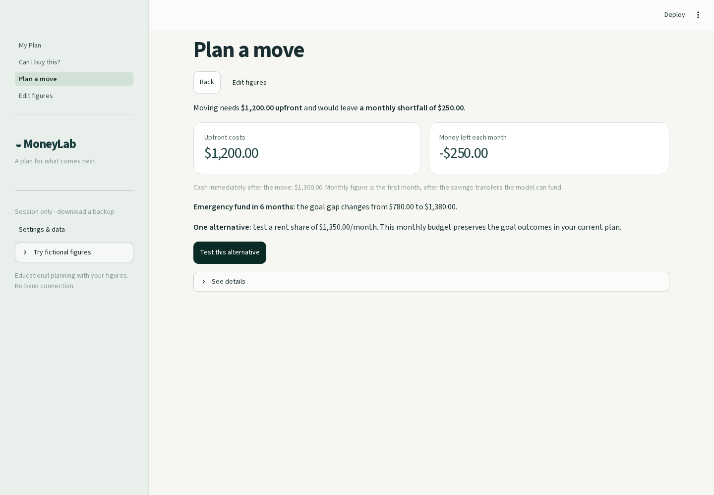
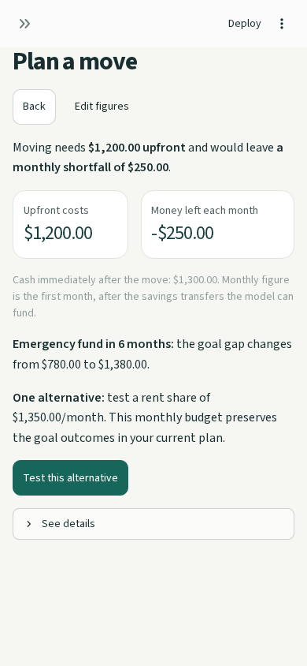
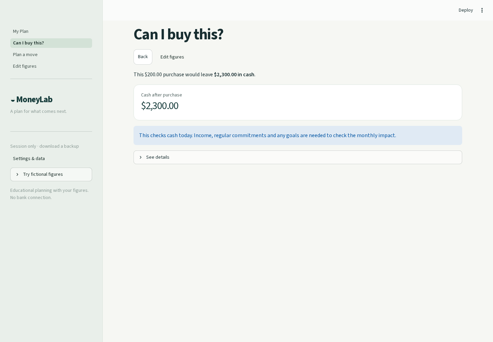
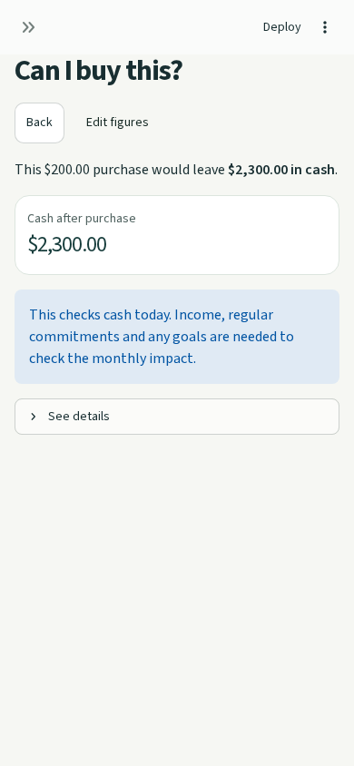

# Before and after: three simpler journeys

Fictional data; desktop 1440 × 1000 and mobile 390 × 844. [Measured counts and financial results](../../streamlined-journeys.md). The latest result-first branch is the baseline; these captures validate the proposed branch locally.

## Savings result

| Viewport | Before | After |
| --- | --- | --- |
| Desktop | [Open](./desktop-before-goal.png) | [Open](./desktop-after-goal.png) |
| Mobile | [Open](./mobile-before-goal.png) | [Open](./mobile-after-goal.png) |

## Test the savings adjustment

| Viewport | Before | After |
| --- | --- | --- |
| Desktop | [Open](./desktop-before-goal-test.png) | [Open](./desktop-after-goal-test.png) |
| Mobile | [Open](./mobile-before-goal-test.png) | [Open](./mobile-after-goal-test.png) |

## Purchase result

| Viewport | Before | After |
| --- | --- | --- |
| Desktop | [Open](./desktop-before-purchase.png) | [Open](./desktop-after-purchase.png) |
| Mobile | [Open](./mobile-before-purchase.png) | [Open](./mobile-after-purchase.png) |

## Move result

| Viewport | Before | After |
| --- | --- | --- |
| Desktop | [Open](./desktop-before-move.png) | [Open](./desktop-after-move.png) |
| Mobile | [Open](./mobile-before-move.png) | [Open](./mobile-after-move.png) |

## Guest cash-only purchase

| Viewport | Before | After |
| --- | --- | --- |
| Desktop | [Open](./desktop-before-guest-purchase.png) | [Open](./desktop-after-guest-purchase.png) |
| Mobile | [Open](./mobile-before-guest-purchase.png) | [Open](./mobile-after-guest-purchase.png) |

## Tested move alternative

[Desktop](desktop-after-move-alternative.png) · [Mobile](mobile-after-move-alternative.png)

The alternative stays hypothetical. The user must explicitly approve before applying it.

[Before click traces](before-audit.json) · [After click traces](after-audit.json) · [Fictional figures](figures.json)
